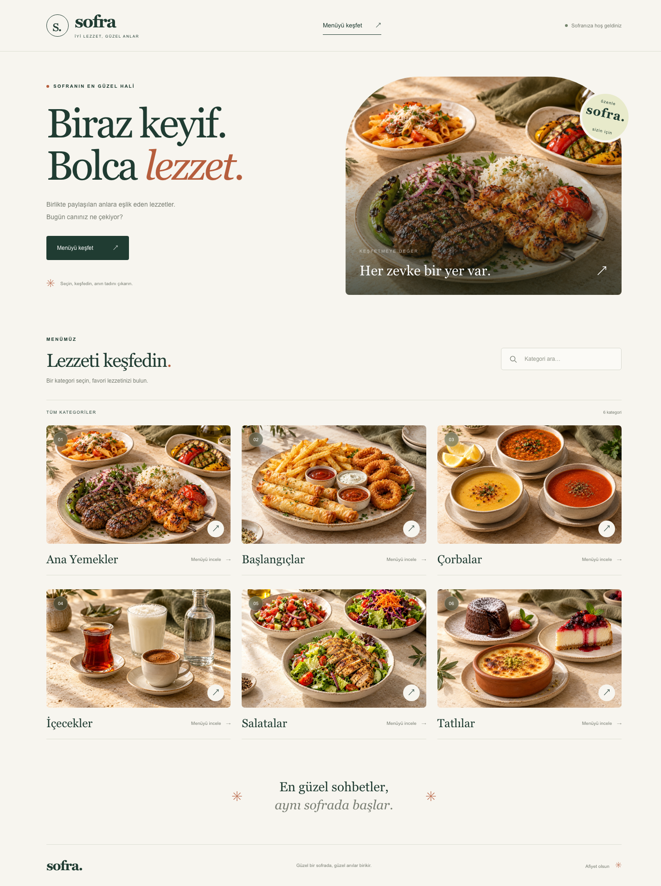
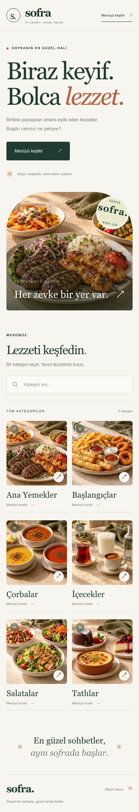
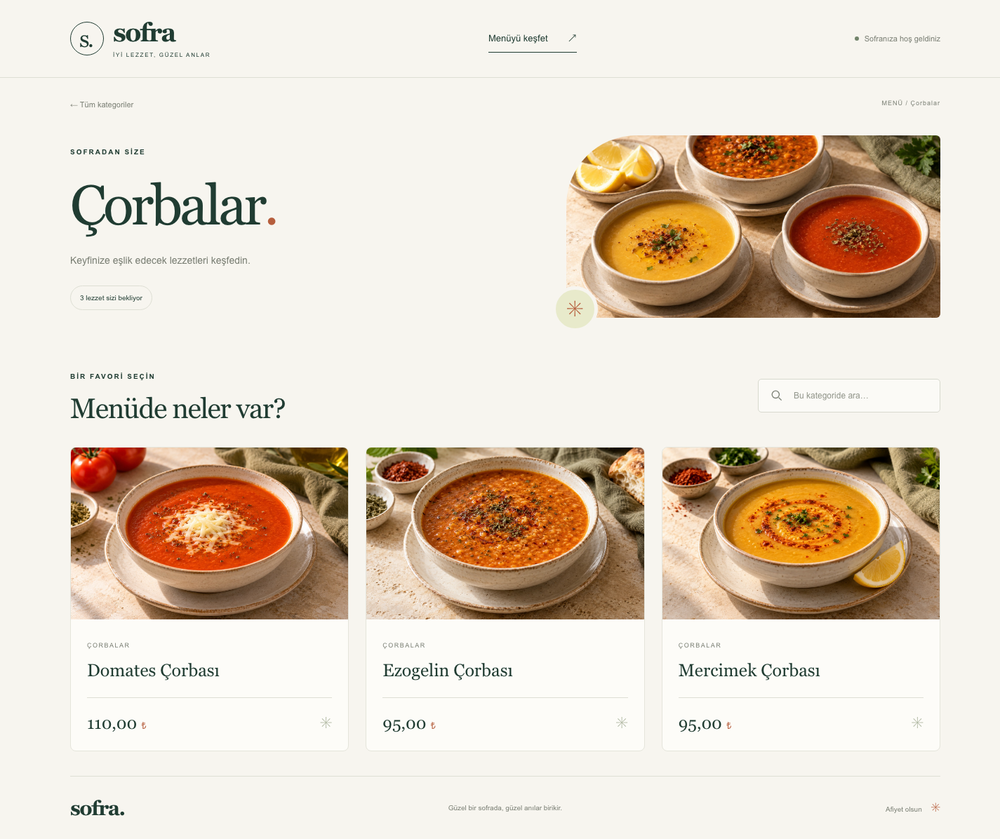
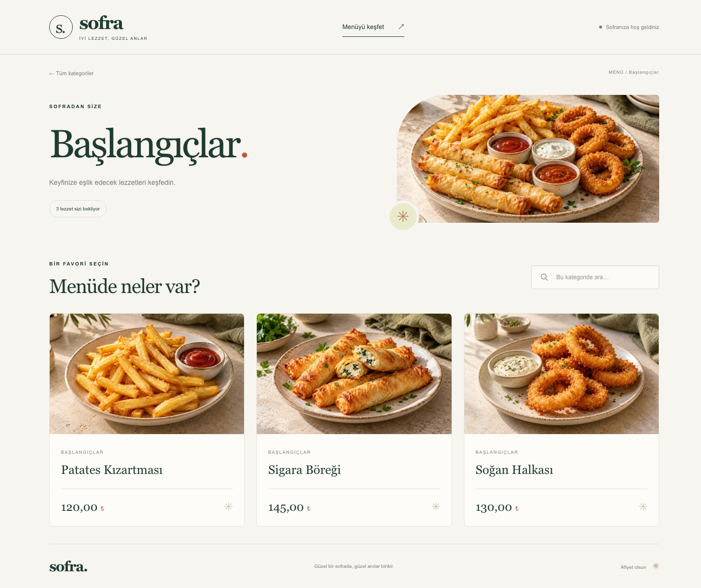
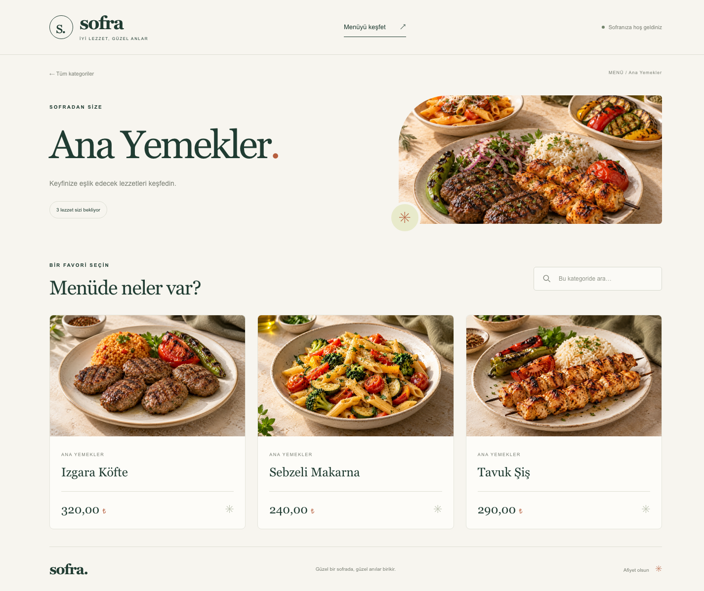
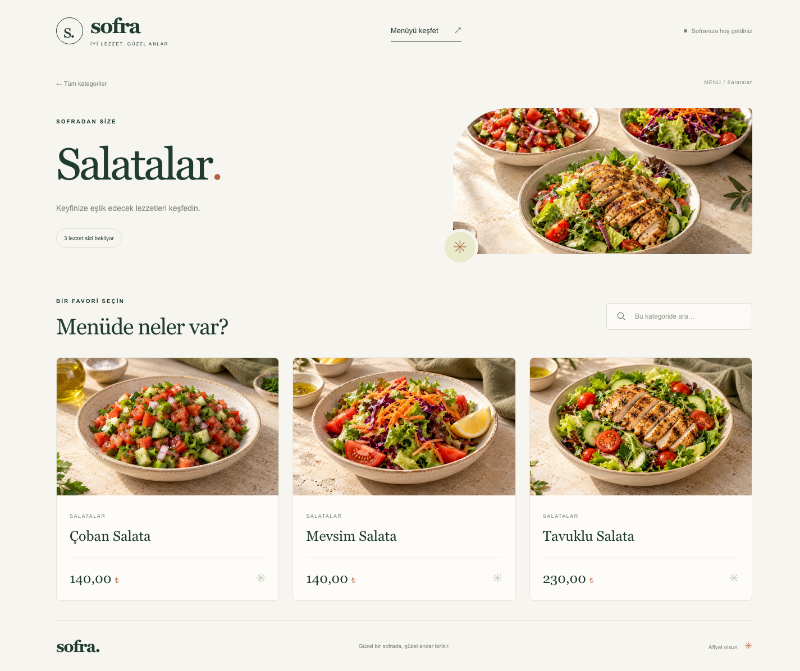
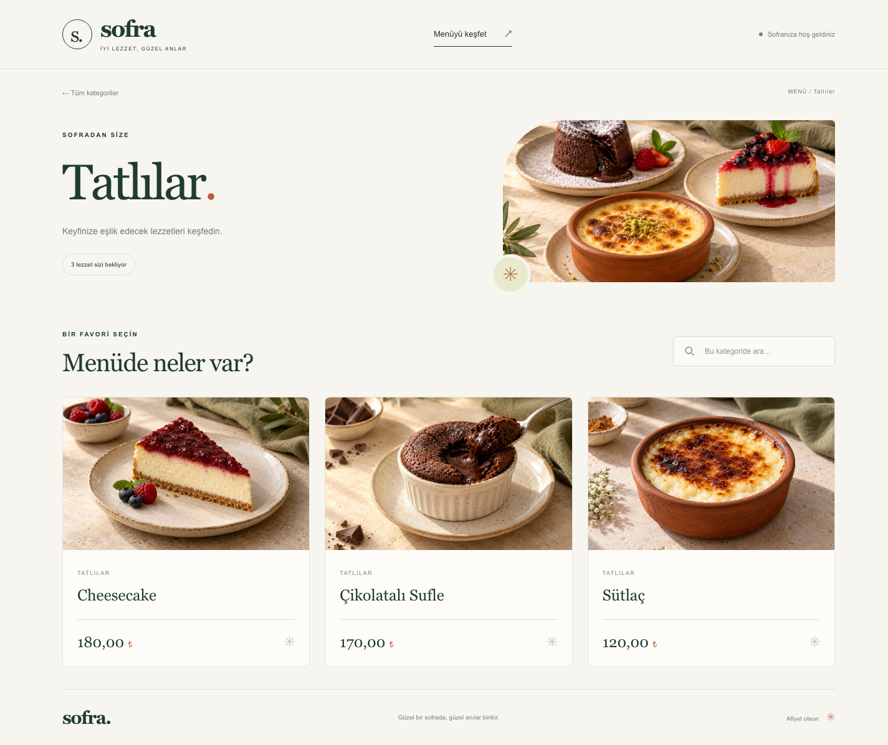
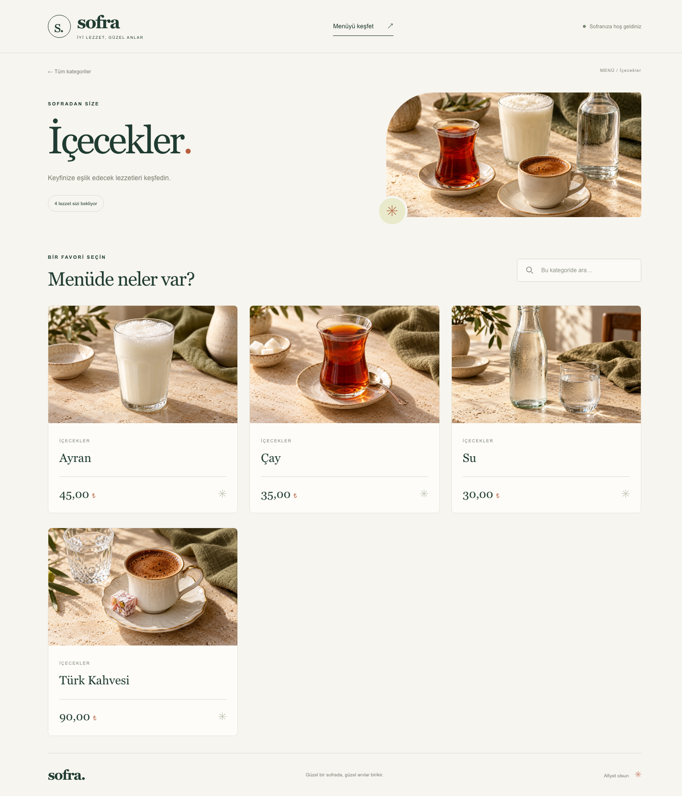

<div align="center">

# Sofra · QR Menü

**Güzel bir sofrada, güzel anılar birikir.**

ASP.NET Core MVC ve SQL Server ile geliştirilmiş, restoran ve kafeler için mobil uyumlu dijital menü uygulaması.

[](https://dotnet.microsoft.com/)
[](https://learn.microsoft.com/aspnet/core/mvc/overview)
[](https://learn.microsoft.com/ef/core/)
[](https://www.microsoft.com/sql-server)

[Ana sayfa](#ana-sayfa) · [Kategori ekranları](#kategori-ekranları) · [Kurulum](#kurulum) · [API](#api)

</div>

## Proje hakkında

Sofra, müşterilerin bir restoranın menüsünü telefonlarından incelemesini sağlayan bir dijital menü projesidir. Ana sayfada kategoriler keşfedilir; her kategori kendine ait, okunabilir bir URL üzerinden ürünleri ve fiyatlarını gösterir. Yayına alınan uygulamanın adresi bir QR koda bağlanarak masalarda paylaşılabilir.

Arayüz; sıcak krem, koyu yeşil ve bakır tonlarını, büyük yemek fotoğraflarını ve serif başlıkları bir araya getirir. Kategori ve ürün bilgileri SQL Server'dan Entity Framework Core ile okunur; Razor görünümlerinde sunulur.

Bu sürüm menü görüntüleme ve aramaya odaklanır. QR kod üretimi, yönetim paneli, sepet, sipariş ve ödeme işlevleri içermez.

## Özellikler

- **Kategori keşfi:** Görselli kategori kartları ve her kategoriye özel detay sayfası.
- **Ürün sunumu:** Ürün adı, fotoğrafı ve Türkçe sayı biçiminde TL fiyatı.
- **Türkçe arama:** Kategorileri veya açık kategorideki ürünleri tarayıcıda filtreleme; ek API isteği gerektirmez.
- **Mobil uyum:** Ekran boyutuna göre düzenlenen kartlar, arama alanları ve gezinme.
- **Tutarlı görsel dil:** Ürün adlarına özel 19 fotoğraf ve kategorileri temsil eden 6 ayrı kompozisyon.
- **Erişilebilirlik:** Klavye odakları, içeriğe geç bağlantısı, arama sonucu duyuruları ve azaltılmış hareket tercihi desteği.
- **Görsel yedeği:** Yüklenemeyen fotoğraflar için yerel yedek görsel.
- **JSON API:** Kategori listesi ve kategoriye ait ürünleri döndüren iki GET uç noktası.

## Ekran görüntüleri

Aşağıdaki görüntüler çalışan uygulamadan, SQL Server'daki 6 kategori ve 19 ürünle alınmıştır. Masaüstü görüntüleri 1440 px, mobil görüntü 390 px genişliğindedir; sayfaların tamamı gösterilir.

### Ana sayfa

Kategori keşfi, menüye geçiş ve kategori araması.



<details>
<summary>Mobil ana sayfayı görüntüle</summary>

<p align="center">
  
</p>

</details>

### Kategori ekranları

Her detay sayfasında kategori görseli, ürün sayısı, ürün araması ve fiyatlı ürün kartları bulunur.

#### Çorbalar

Mercimek Çorbası · Ezogelin Çorbası · Domates Çorbası



#### Başlangıçlar

Patates Kızartması · Soğan Halkası · Sigara Böreği



#### Ana Yemekler

Izgara Köfte · Tavuk Şiş · Sebzeli Makarna



#### Salatalar

Çoban Salata · Mevsim Salata · Tavuklu Salata



#### Tatlılar

Sütlaç · Çikolatalı Sufle · Cheesecake



#### İçecekler

Su · Ayran · Çay · Türk Kahvesi



## Teknolojiler ve yapı

| Katman | Teknoloji / sorumluluk |
| --- | --- |
| Uygulama | .NET 10, ASP.NET Core MVC, C# |
| Arayüz | Razor Views, Bootstrap 5, özel CSS ve JavaScript |
| Veri erişimi | Entity Framework Core 10, `AsNoTracking` sorguları ve DTO projeksiyonları |
| Veritabanı | Microsoft SQL Server 2022 |
| Yerel altyapı | Docker Compose ile SQL Server |

```text
aspnet-qrmenu/
├── Controllers/             # MVC sayfaları ve kategori API'si
├── Data/                    # AppDbContext ve model ilişkileri
├── Entity/                  # Category ve Product varlıkları
├── Models/                  # ViewModel ve DTO'lar
├── Migrations/              # EF Core veritabanı şeması
├── Views/
│   ├── Home/                # Ana sayfa ve kategori detayı
│   └── Shared/              # Ortak sayfa düzeni
├── wwwroot/
│   ├── css/                 # Sofra tasarım sistemi
│   ├── js/                  # Sayfa içi arama ve görsel yedeği
│   └── images/menu/         # Ürün ve kategori fotoğrafları
├── docs/screenshots/        # Gerçek uygulama ekran görüntüleri
├── scripts/                 # Ekran görüntüsü alma aracı
├── output/menu-images/      # Görsel promptları, eşleştirmeler ve SQL betikleri
└── compose.yaml             # Yerel SQL Server servisi
```

Bir kategorinin birden fazla ürünü bulunur. `Product.CategoryId` bu ilişkiyi kurar. Kategori `Slug` alanı benzersizdir; ürün fiyatları `decimal(18,2)` olarak saklanır. İlişkili ürünleri olan kategoriler için veritabanında silme kısıtı uygulanır.

## Kurulum

### Gereksinimler

- .NET 10 SDK
- Docker ve Docker Compose veya erişilebilir bir SQL Server
- Migration komutları için EF Core 10 CLI

### 1. Projeyi indirin

```bash
git clone https://github.com/seyitbugraerden/aspnet-qrmenu.git
cd aspnet-qrmenu
dotnet restore
```

### 2. SQL Server'ı başlatın

Proje kökünde `.env` dosyası oluşturup yerel veritabanı için güçlü bir parola belirleyin:

```dotenv
SQL_SA_PASSWORD=YOUR_STRONG_LOCAL_PASSWORD
```

```bash
docker compose up -d
```

SQL Server `127.0.0.1:1433` üzerinden erişilir; verileri `sqlserver_data` isimli Docker volume'ünde saklanır. Compose yapılandırması `linux/amd64` kullanır; ARM sistemlerde Docker'ın bu platformu çalıştırabilmesi gerekir.

### 3. Bağlantıyı tanımlayın

Aşağıdaki örnekteki parolayı `.env` dosyasındaki değerle değiştirin. Bağlantı bilgisini kaynak koda eklemeden .NET User Secrets içinde saklayın:

```bash
dotnet user-secrets set "ConnectionStrings:DefaultConnection" "Server=127.0.0.1,1433;Database=QrMenuDb;User Id=sa;Password=YOUR_STRONG_LOCAL_PASSWORD;TrustServerCertificate=True;"
```

User Secrets geliştirme ortamında yüklenir. Sunucu ortamında aynı bağlantı bilgisini `ConnectionStrings__DefaultConnection` ortam değişkeniyle sağlayabilirsiniz. `.env` yalnızca Docker Compose tarafından kullanılır; uygulamanın bağlantı dizesini kendiliğinden oluşturmaz.

### 4. Veritabanını oluşturun

EF CLI yüklü değilse:

```bash
dotnet tool install --global dotnet-ef --version '10.*'
```

```bash
dotnet ef database update -- --environment Development
```

Migration'lar tabloları oluşturur; **örnek kategori ve ürünleri otomatik eklemez**. README'deki ekran görüntüleri yerel veritabanındaki mevcut menüyü gösterir. Yeni bir veritabanında `Categories` ve `Products` tablolarına kayıt eklenmelidir.

Örneğin SQL Server üzerinde aşağıdaki sorgu bir kategori ve ona bağlı bir ürün oluşturur; ilgili fotoğraflar projede bulunur:

```sql
DECLARE @CategoryId int;

INSERT INTO Categories (CategoryName, CategoryImage, Slug)
VALUES (N'Çorbalar', '/images/menu/categories/corbalar.jpg', 'corbalar');

SET @CategoryId = CONVERT(int, SCOPE_IDENTITY());

INSERT INTO Products (ProductName, Image, Price, CategoryId)
VALUES (N'Mercimek Çorbası', '/images/menu/products/mercimek-corbasi.jpg', 120.00, @CategoryId);
```

Bu örneği boş bir veritabanında bir kez çalıştırın; fiyat yalnızca kurulum örneğidir.

### 5. Uygulamayı çalıştırın

```bash
dotnet run --launch-profile http
```

Uygulama: **http://localhost:5069**

HTTPS profili için `dotnet run --launch-profile https` kullanılabilir. Yerel geliştirme sertifikası gerekirse `dotnet dev-certs https --trust` komutuyla tanımlanabilir.

## API

| Yöntem | Adres | Sonuç |
| --- | --- | --- |
| `GET` | `/api/category` | Kategorilerin `id`, `categoryName` ve `slug` alanları |
| `GET` | `/api/category/{slug}` | Kategori bilgileri, kategori görseli ve ürün listesi |

```bash
curl http://localhost:5069/api/category
curl http://localhost:5069/api/category/corbalar
```

Olmayan bir kategori slug'ı için detay uç noktası `404 Not Found` döndürür. MVC tarafında ana sayfa `/`, kategori detayları `/{slug}` adresindedir. API yalnızca okuma uç noktaları sunar.

## Görsel materyaller

Menü fotoğrafları yapay zekâ ile, her ürünün ve kategorinin adına özel olarak üretilmiştir; gerçek mutfak çekimleri değildir. Ortak stil; sıcak gün ışığı, krem taş yüzeyler, sade seramikler ve zeytin yeşili dokulardan oluşur.

- Ürünler: [`wwwroot/images/menu/products/`](wwwroot/images/menu/products/)
- Kategoriler: [`wwwroot/images/menu/categories/`](wwwroot/images/menu/categories/)
- Üretim promptları ve kayıt eşleştirmeleri: [`manifest.json`](output/menu-images/manifest.json)

`output/menu-images/` altındaki SQL betikleri görsellerin üretildiği mevcut veritabanının kayıt kimlikleri ve önceki yolları için hazırlanmıştır; genel amaçlı veri ekleme betikleri değildir. `apply-images.sql` yalnızca beklenen kayıtlar eşleşirse görsel yollarını günceller. `restore-images.sql` önceki görsel yollarına dönüş içindir.

## Ekran görüntülerini yenileme

Çalışan uygulama, Node.js 22+ ve Chrome gerektirir. Ek npm paketi kullanılmaz. Chrome'u ayrı bir geçici profille başlatın:

```bash
# macOS
"/Applications/Google Chrome.app/Contents/MacOS/Google Chrome" \
  --headless=new \
  --remote-debugging-port=9223 \
  --user-data-dir=/tmp/qrmenu-readme-chrome
```

Başka bir terminalde:

```bash
node scripts/capture-screenshots.mjs
```

Araç kategorileri API'den okur, ana sayfa ve her kategori için tam sayfa ekran görüntüsü alır; mobil ana sayfayı da kaydeder. Görsellerin yüklenmesini, kartların varlığını ve yatay taşmayı kontrol eder. Sonuçlar `docs/screenshots/capture-report.json` dosyasına yazılır. Uygulama ve Chrome adresleri `MENU_URL` ve `CHROME_DEBUG_URL` ortam değişkenleriyle değiştirilebilir.
